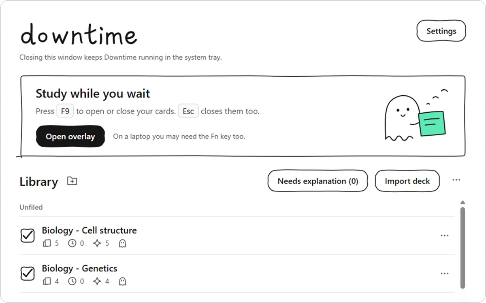
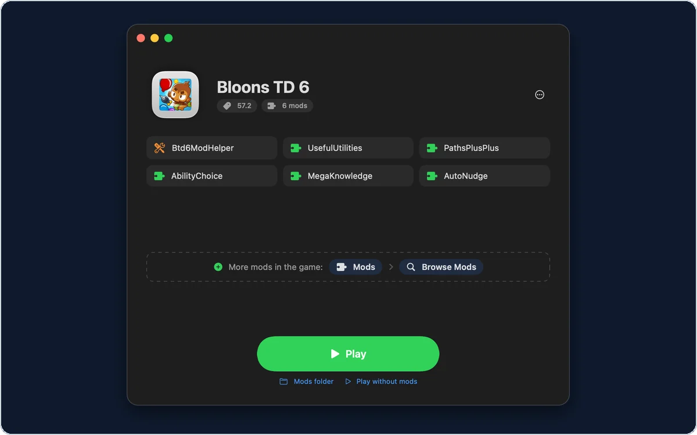
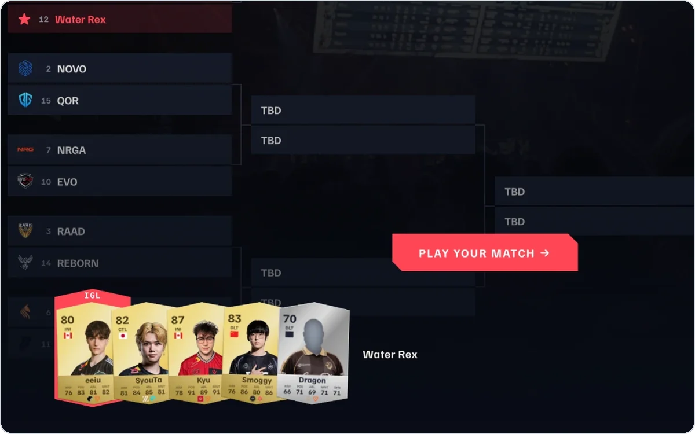
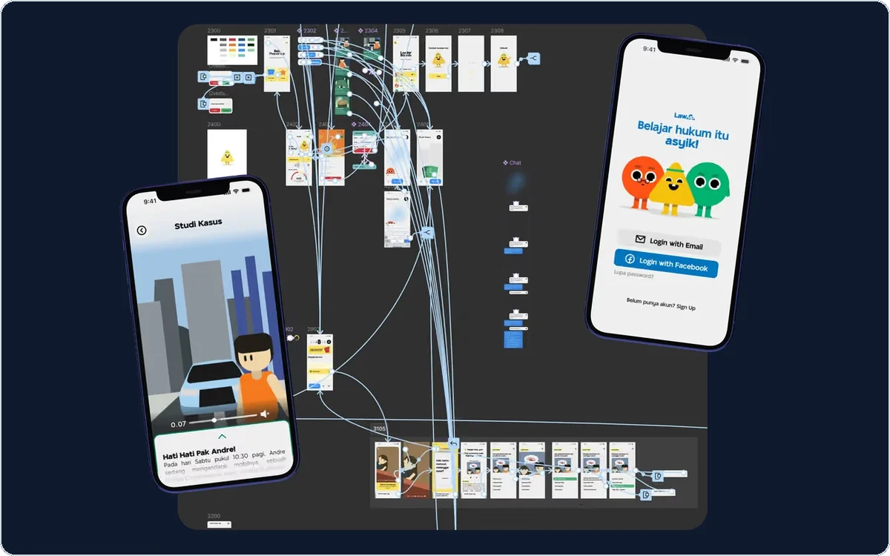

<picture>
  <source media="(prefers-color-scheme: dark)" srcset="garden/garden-dark.svg" />
  <source media="(prefers-color-scheme: light)" srcset="garden/garden-light.svg" />
  
</picture>

<h1>Hi, I'm Dimas 👋</h1>

I'm a designer who builds apps, tools and games.

[Portfolio](https://dimas.works) &emsp; [LinkedIn](https://linkedin.com/in/dimasgistha)

<table>
<tr>
<td width="423" valign="top">
 
<a href="https://github.com/dimslalom/Downtime"><strong>Downtime</strong></a> 
Flashcards for the downtime in your games
</td>
<td width="423" valign="top">
 
<a href="https://github.com/dimslalom/btd6-macaque-mod-loader"><strong>MacaqueLoader</strong></a> 
Mods for Bloons TD 6 on Apple Silicon Macs
</td>
</tr>
<tr>
<td width="423" valign="top">
 
<a href="https://github.com/dimslalom/2605-Valorant-Fantasy-League"><strong>Valorant Fantasy League</strong></a> 
Draft pro players as cards and run them through simulated tournaments
</td>
<td width="423" valign="top">
 
<a href="https://dimas.works"><strong>LAWup</strong></a> UX 
A gamified app that makes Indonesian law approachable
</td>
</tr>
</table>

<picture>
  <source media="(prefers-color-scheme: dark)" srcset="asset/tools-dark.svg" />
  <source media="(prefers-color-scheme: light)" srcset="asset/tools-light.svg" />
  
</picture>
